# HomeSense: Smart Home IoT Project

HomeSense is a small IoT system that collects temperature, humidity and motion data from a (simulated) smart home device, stores it in the cloud, and exposes it through a REST API. The user can also send commands (e.g. heater on/off) back to the device.

## Business outline

Homeowners want to keep an eye on the comfort and energy use of their home, even when they are away. HomeSense gives them a simple way to see current and historical sensor data and to control a heater remotely. Because everything is exposed through a REST API, other applications (mobile apps, dashboards) can integrate with it easily.

The full business context (use cases, user stories, scope) is in [docs/business-context.md](docs/business-context.md).

### User stories

- As a **homeowner**, I want to see my home's current temperature and humidity so that I can check comfort levels remotely.
- As a **homeowner**, I want to view historical sensor data so that I can analyze trends and reduce energy usage.
- As a **homeowner**, I want to send a command (e.g. heater on/off) to my device so that I can control my home when I am away.
- As a **developer**, I want clear REST API documentation so that I can easily integrate the IoT device with other applications.

## Architecture

The architecture follows the [C4 model](https://c4model.com/).

### System Context diagram

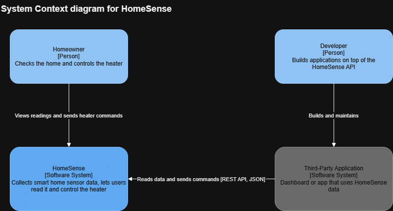

### Container diagram

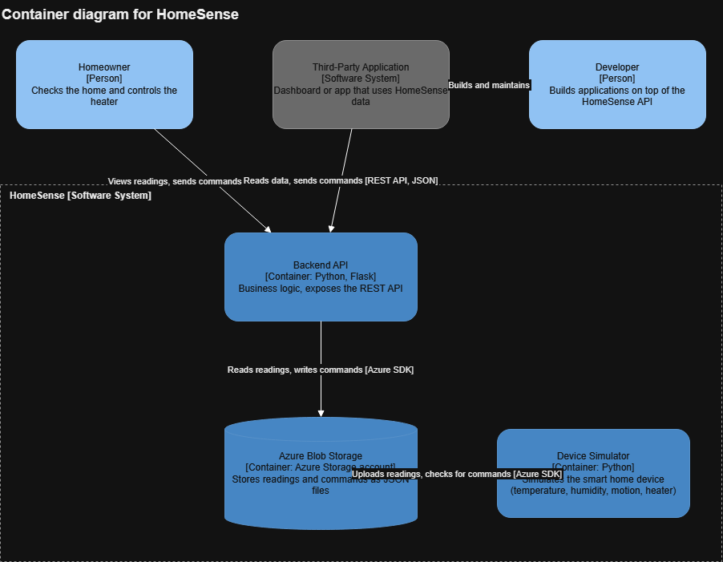

The HomeSense system consists of three containers:

1. **Device simulator** (`simulator.py`): generates a reading every 5 seconds, uploads it to Azure Blob Storage, and checks the cloud for new commands.
2. **Cloud storage**: Azure Blob Storage, container `readings`. Readings are stored as `livingroom-01/<timestamp>.json`, commands as `commands/livingroom-01.json`.
3. **Backend** (`backend.py`): a Flask application that implements the business logic and exposes the REST API.

The REST API is tested with the **Postman collection** in this repository. The editable diagram source is `docs/homesense.drawio`.

## Cost estimate

See the Azure Pricing Calculator estimate in `docs/azure-estimate.xlsx`. Assumptions: one device sending a reading every 5 seconds, Standard LRS Blob Storage (Hot tier), about 600,000 write and 600,000 read operations per month. The estimated cost is about $4 per month.

A cost calculation for 1000 devices and 300 customers is in [docs/cost-calculation.md](docs/cost-calculation.md).

## Prerequisites

- Python 3.10 or newer
- An Azure account with a Storage account that has a container named `readings`
- Postman (optional, for testing the API)

## Installation

1. Clone the repository:
   ```
   git clone https://github.com/erenonak/homesense.git
   cd homesense
   ```
2. Install the dependencies:
   ```
   pip install -r requirements.txt
   ```
3. Create a file named `config.py` in the project folder with your Azure Storage connection string (Azure Portal → Storage account → Security + networking → Access keys):
   ```python
   CONNECTION_STRING = "your-connection-string-here"
   ```
   `config.py` is listed in `.gitignore`, so the secret is never committed.

## Running the project

Open two terminals in the project folder.

**Terminal 1: start the device simulator**
```
python simulator.py
```
You should see a `Sent: {...}` line every 5 seconds.

**Terminal 2: start the backend**
```
python backend.py
```
The API is now available at `http://127.0.0.1:5000`.

## REST API

| Method | Endpoint | Description |
|---|---|---|
| GET | `/devices/{id}/readings/latest` | Latest sensor reading |
| GET | `/devices/{id}/readings?limit=20` | Last N readings (default 20) |
| POST | `/devices/{id}/commands` | Send a command to the device |

Example command request body:
```json
{ "command": "heater_on" }
```
Allowed commands: `heater_on`, `heater_off`. The simulator picks the command up within a few seconds, and the temperature then rises in the following readings.

## Testing with Postman

The Postman collection `postman/homesense.postman_collection.json` tests the REST API. Import it into Postman (Import → select the file) and start the API first (`docker compose up -d --build`).

| Request | Method | Endpoint | Expected result |
|---|---|---|---|
| Get latest reading | GET | `/devices/{deviceId}/readings/latest` | 200, latest reading |
| Get reading history | GET | `/devices/{deviceId}/readings?limit=10` | 200, list of readings |
| Send command: heater_on | POST | `/devices/{deviceId}/commands` | 201, command echoed back |
| Send command: heater_off | POST | `/devices/{deviceId}/commands` | 201, command echoed back |
| Send invalid command | POST | `/devices/{deviceId}/commands` | 400, error message |

The collection uses two variables, `baseUrl` (default `http://127.0.0.1:5000`) and `deviceId` (default `livingroom-01`), and every request has automated tests. The screenshot shows a successful run of the whole collection:

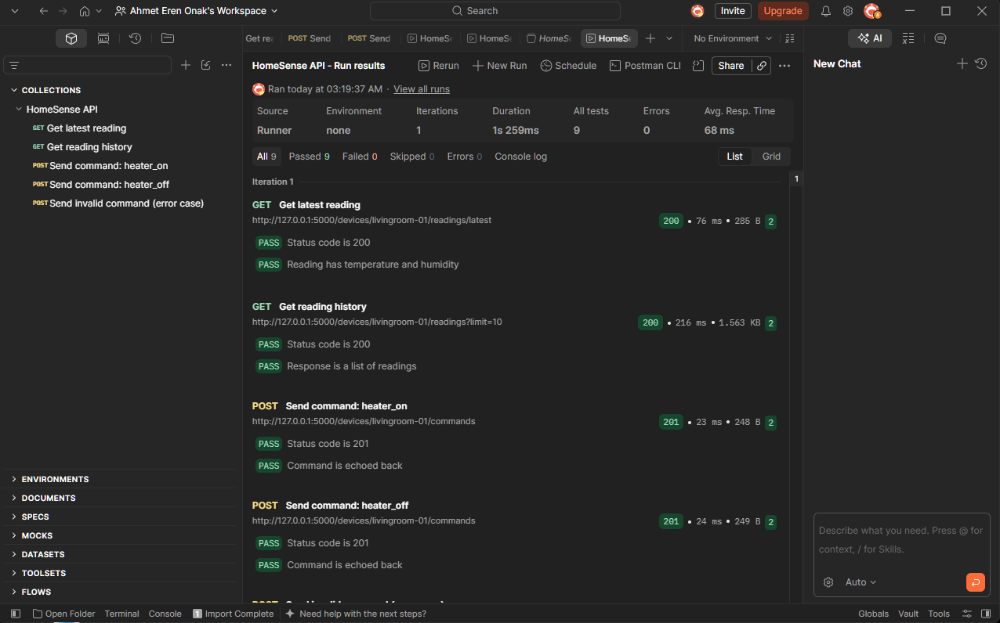

## MQTT broker

The MQTT broker is an Eclipse Mosquitto instance running in Docker (`mqtt-broker/`).

Start the broker:
```
cd mqtt-broker
docker compose up -d
```

Topics used by HomeSense:

- `homesense/<deviceId>/telemetry`: sensor readings sent by the device
- `homesense/<deviceId>/commands`: commands sent to the device (e.g. `heater_on`)

Quick test (two terminals):
```
docker exec -it homesense-mqtt mosquitto_sub -t "homesense/#" -v
docker exec homesense-mqtt mosquitto_pub -t "homesense/livingroom-01/telemetry" -m "hello"
```

The screenshot below shows a test message being published and received by the broker:

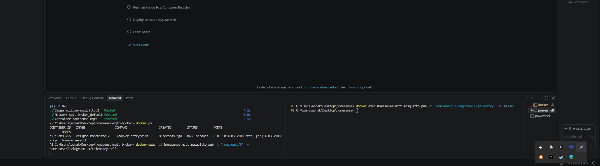

## MQTT device simulator

`mqtt_simulator.py` simulates the smart home device. It connects to the MQTT broker and:

- publishes a reading (temperature, humidity, motion, heater state) every 5 seconds to `homesense/livingroom-01/telemetry`
- subscribes to `homesense/livingroom-01/commands` and switches the simulated heater when it receives `heater_on` or `heater_off`

Run it (the broker must be running first):
```
pip install -r requirements.txt
python mqtt_simulator.py
```

Send a command to the device:
```
docker exec homesense-mqtt mosquitto_pub -t "homesense/livingroom-01/commands" -m "heater_on"
```

The device accepts plain text (`heater_on`, `heater_off`) or JSON (`{"command": "heater_on"}`).

### Demo

**1. Sending the `heater_on` command to the broker**

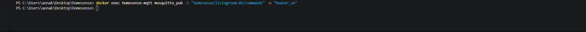

**2. The device receives the command and the simulated heater is switched on**

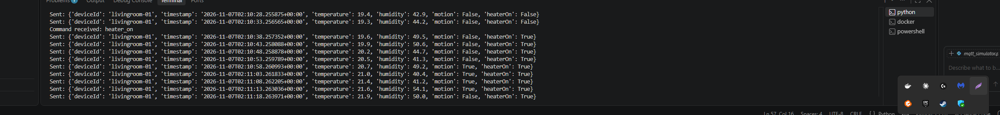

**3. Sending `heater_off` switches the heater off again**

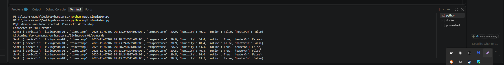

The broker listens on port 1883 and allows anonymous connections, which is fine for a local demo but should be replaced by username/password or TLS in production.


## Data storage

HomeSense stores its data in **Azure Blob Storage**.

| Setting | Value |
|---|---|
| Service | Azure Storage account (Standard performance, general-purpose v2) |
| Region | Poland Central |
| Redundancy | Locally-redundant storage (LRS) |
| Access tier | Hot |
| Container | `readings` (private access) |

Blob layout inside the `readings` container:

- `livingroom-01/<timestamp>.json`: one JSON file per sensor reading
- `commands/livingroom-01.json`: the latest command for the device

Example reading:
```json
{
  "deviceId": "livingroom-01",
  "timestamp": "2026-11-03T23:30:52.122961+00:00",
  "temperature": 21.0,
  "humidity": 54.5,
  "motion": false,
  "heaterOn": false
}
```

Blob Storage was chosen because the readings are small, append-only JSON documents that are only read in simple ways (latest reading, last N readings), and it is the cheapest option for this workload (see the cost estimate above). The application accesses the storage with a connection string kept in `config.py`, which is not committed to the repository.

The screenshots show the storage account, the container with the stored readings, and the content of one reading:

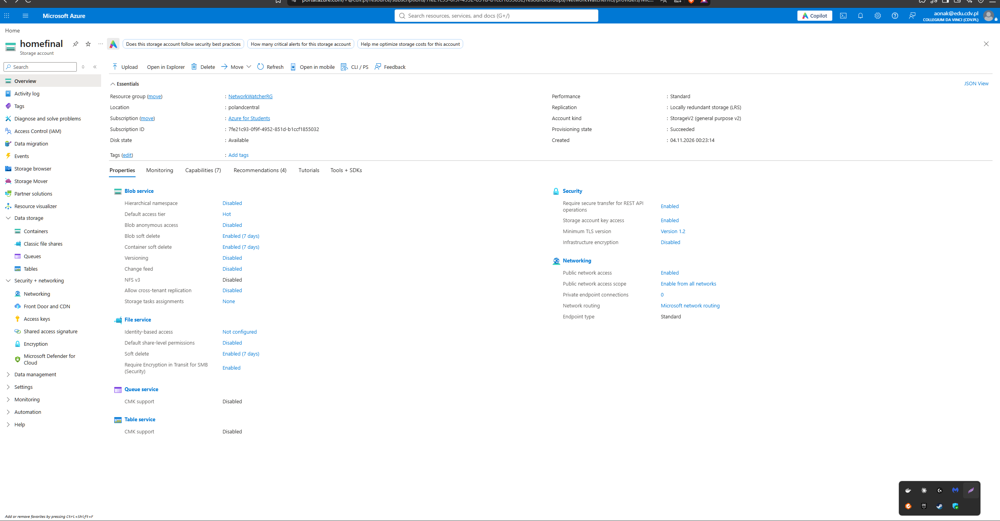

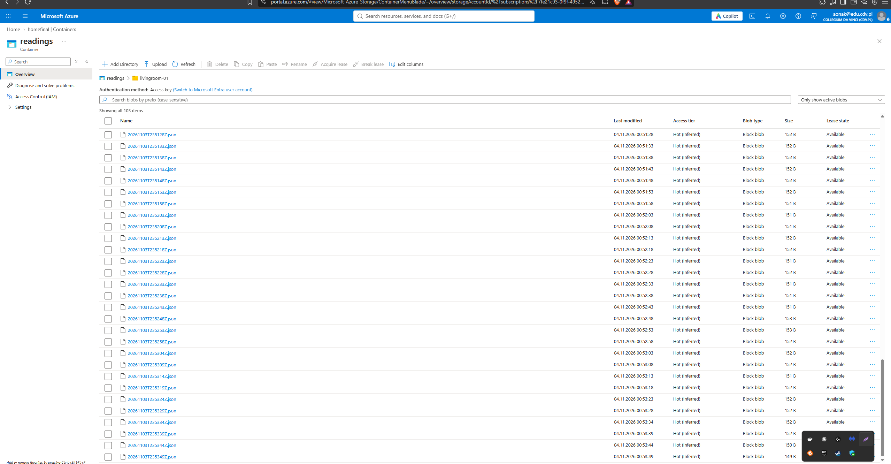

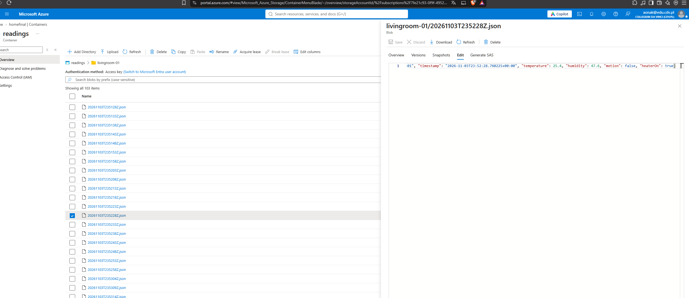

## Infrastructure as code

The Azure infrastructure (storage account and the `readings` blob container) is defined with **Bicep** in `infra/main.bicep`. The MQTT broker is defined in `mqtt-broker/docker-compose.yml`.

Deploy the Azure resources (Azure CLI or Azure Cloud Shell):
```
az group create --name homesense-iac-rg --location polandcentral
az deployment group create --resource-group homesense-iac-rg --template-file infra/main.bicep
```

The template creates a Standard LRS storage account (Hot tier, TLS 1.2, no public blob access) and a private container named `readings`. The storage account name is generated from a prefix and a unique suffix because storage account names must be globally unique.

Remove the resources again:
```
az group delete --name homesense-iac-rg
```

The screenshots show the successful deployment and the resources created in Azure:

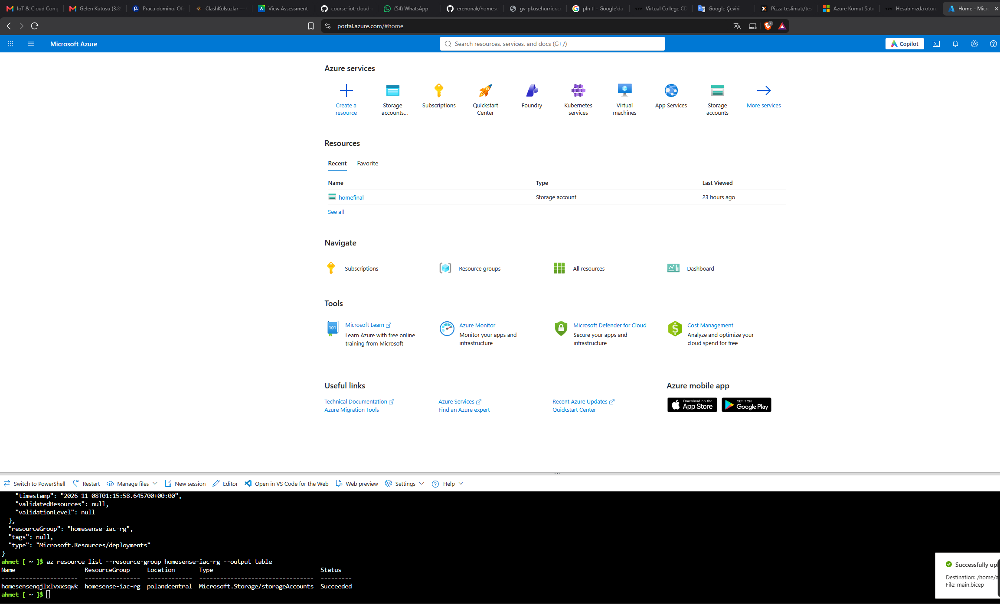

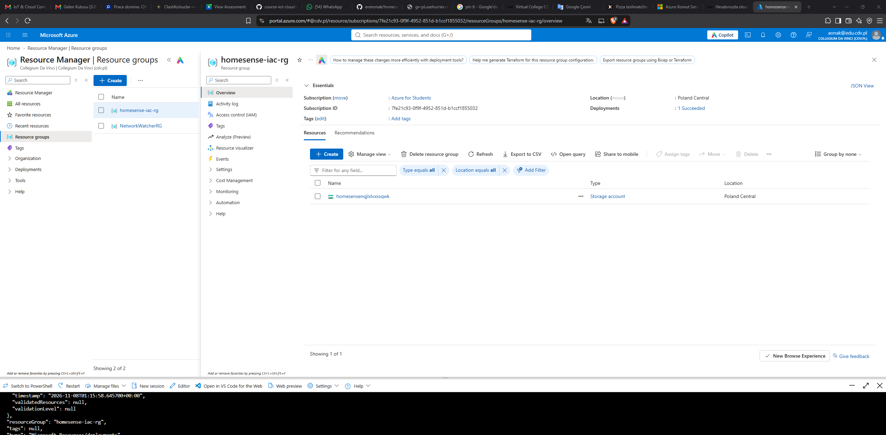


## REST API server (Docker)

The REST API (`backend.py`, Flask served by Gunicorn) runs in a Docker container. The image is defined in `Dockerfile` and started with `docker-compose.yml`.

Create a file named `.env` in the project folder with the Azure Storage connection string (it is listed in `.gitignore` and never committed):
```
CONNECTION_STRING=your-connection-string-here
```

Build and start the server:
```
docker compose up -d --build
```
The API is available at `http://127.0.0.1:5000`. Stop it with `docker compose down`.

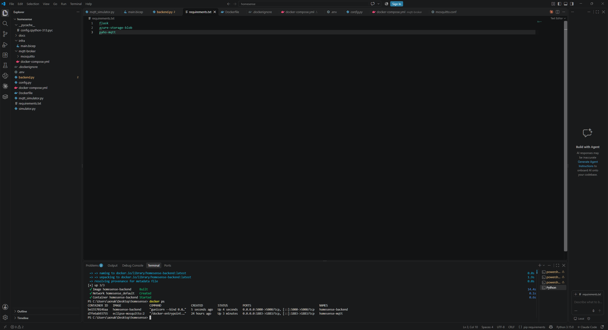

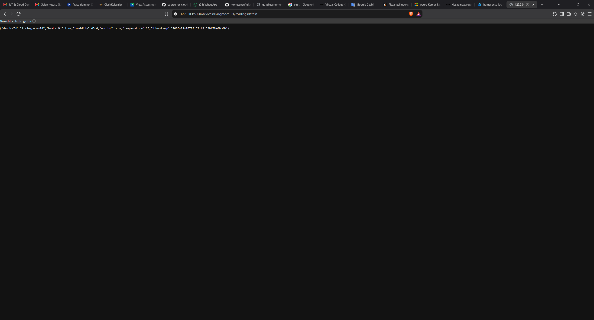
