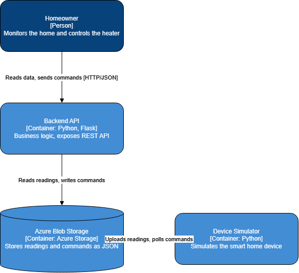

# HomeSense: Smart Home IoT Project

HomeSense is a small IoT system that collects temperature, humidity and motion data from a (simulated) smart home device, stores it in the cloud, and exposes it through a REST API. The user can also send commands (e.g. heater on/off) back to the device.

## Business outline

Homeowners want to keep an eye on the comfort and energy use of their home, even when they are away. HomeSense gives them a simple way to see current and historical sensor data and to control a heater remotely. Because everything is exposed through a REST API, other applications (mobile apps, dashboards) can integrate with it easily.

### User stories

- As a **homeowner**, I want to see my home's current temperature and humidity so that I can check comfort levels remotely.
- As a **homeowner**, I want to view historical sensor data so that I can analyze trends and reduce energy usage.
- As a **homeowner**, I want to send a command (e.g. heater on/off) to my device so that I can control my home when I am away.
- As a **developer**, I want clear REST API documentation so that I can easily integrate the IoT device with other applications.

## Architecture



1. **Device simulator** (`simulator.py`): generates a reading every 5 seconds, uploads it to Azure Blob Storage, and checks the cloud for new commands.
2. **Cloud storage**: Azure Blob Storage, container `readings`. Readings are stored as `livingroom-01/<timestamp>.json`, commands as `commands/livingroom-01.json`.
3. **Backend** (`backend.py`): a Flask application that implements the business logic and exposes the REST API.
4. **Postman collection**: used to test the REST API.

## Cost estimate

See the Azure Pricing Calculator estimate in `docs/azure-estimate.xlsx`. Assumptions: one device sending a reading every 5 seconds, Standard LRS Blob Storage (Hot tier), about 600,000 write and 600,000 read operations per month. The estimated cost is about $4 per month..

## Prerequisites

- Python 3.10 or newer
- An Azure account with a Storage account that has a container named `readings`
- Postman (optional, for testing the API)

## Installation

1. Clone the repository:
   ```
   git clone https://github.com/erenonak/homesense.git
   cd homesense
   ```
2. Install the dependencies:
   ```
   pip install -r requirements.txt
   ```
3. Create a file named `config.py` in the project folder with your Azure Storage connection string (Azure Portal → Storage account → Security + networking → Access keys):
   ```python
   CONNECTION_STRING = "your-connection-string-here"
   ```
   `config.py` is listed in `.gitignore`, so the secret is never committed.

## Running the project

Open two terminals in the project folder.

**Terminal 1: start the device simulator**
```
python simulator.py
```
You should see a `Sent: {...}` line every 5 seconds.

**Terminal 2: start the backend**
```
python backend.py
```
The API is now available at `http://127.0.0.1:5000`.

## REST API

| Method | Endpoint | Description |
|---|---|---|
| GET | `/devices/{id}/readings/latest` | Latest sensor reading |
| GET | `/devices/{id}/readings?limit=20` | Last N readings (default 20) |
| POST | `/devices/{id}/commands` | Send a command to the device |

Example command request body:
```json
{ "command": "heater_on" }
```
Allowed commands: `heater_on`, `heater_off`. The simulator picks the command up within a few seconds, and the temperature then rises in the following readings.

## Testing with Postman

Import the collection file from this repository into Postman and send the requests while the simulator and backend are running.
