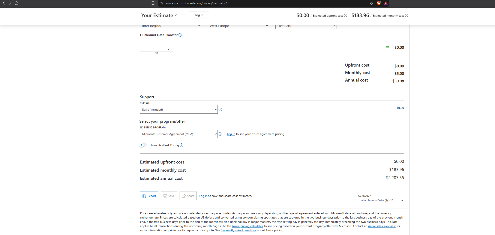

# Cost calculation: 1000 devices and 300 customers

Estimate created with the [Azure Pricing Calculator](https://azure.microsoft.com/en-us/pricing/calculator/) (pay-as-you-go, region West Europe, USD). The full estimate is in `cost-estimate-1000-devices.xlsx`.

## Assumptions

- 1000 devices, each sending one reading per minute (43.2 million readings per month). The demo simulator sends a reading every 5 seconds, but at 1000 devices that would be about 518 million messages per month, so a production device would send less often.
- One reading is about 250 bytes, so about 10.8 GB per month. Data is kept for 12 months (about 130 GB).
- The backend collects the readings and writes one file per device per hour: 720,000 write operations per month.
- 300 customers make about 200 API requests per day each: 1.8 million requests per month. Each request reads about 5 blobs (9 million read operations per month) and returns about 5 KB (about 9 GB outbound traffic per month).
- One virtual machine runs the Mosquitto MQTT broker (about 17 messages per second is a small load, a B2s instance with 2 vCPUs and 4 GB RAM is enough).
- The REST API runs as a Docker image on Azure App Service with 2 instances for availability, and the image is stored in Azure Container Registry.
- No reservations or discounts are used.

## Resources and monthly cost

| Resource | Configuration | Monthly cost (USD) |
|---|---|---|
| App Service (REST API) | Linux, Standard S1, 2 instances, 730 h | 138.70 |
| Virtual Machine (MQTT broker) | Linux, B2s (2 vCPU, 4 GB RAM), 730 h, Standard SSD | 31.90 |
| Storage account (Blob) | Hot, LRS, 130 GB, about 9.9 million operations | 8.36 |
| Container Registry | Basic | 5.00 |
| **Total per month** | | **183.96** |
| **Total per year** | | **2,207.55** |

## Unit costs

- Cost per device per month: 183.96 ÷ 1000 ≈ 0.18 USD (about 2.21 USD per year)
- Cost per customer per month: 183.96 ÷ 300 ≈ 0.61 USD (about 7.36 USD per year)

## Comments

- The largest cost item is the App Service for the REST API (about 75% of the total), because two Standard instances run all month for availability. The MQTT broker VM is second (about 17%).
- Storage is cheap (about 5%) because the readings are small and written in hourly batches instead of one file per reading.
- Possible savings: one App Service instance or a smaller plan at the start, 1-year or 3-year reservations for the VM and App Service, and moving older data to the Cool tier.
